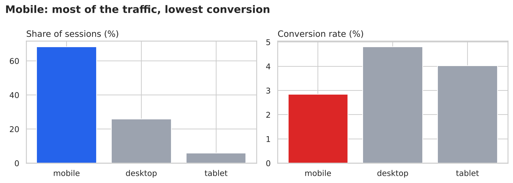

# 🛒 Product Funnel & Conversion Rate Optimization

> **Status:** 🚧 In progress: Day 1 of 3 complete (data quality, cleaning, EDA).
> SQL deep-dive, A/B test, dashboard and final recommendations are coming next.

An end-to-end analysis of an e-commerce conversion funnel: from raw, messy clickstream exports to
a clear answer to the question every product and growth team asks:

**"Where are we losing customers, why, and what should we fix first?"**

---

## 📌 Business problem

*ShopNest*, a fictional Indian D2C e-commerce brand, gets ~80,000 sessions a quarter but only **3.4%** of them
turn into orders. Two-thirds of traffic is on mobile, and the product team has just launched a
**one-page checkout** experiment. Leadership wants to know:

1. Which funnel step loses the most customers, and which loss is the most valuable to fix?
2. Which segments (device, channel, city tier, page speed, new vs returning) under-perform?
3. Did the one-page checkout actually work, and should it be rolled out?
4. What is the ₹ impact of each recommendation?

## 🔢 Headline numbers (Aug–Oct 2026, bots excluded)

| Sessions | Orders | Conversion rate | Revenue | AOV | Cart abandonment |
|---|---|---|---|---|---|
| 80,000 | 2,734 | **3.42%** | ₹44.8 lakh | ₹1,640 | **67.9%** |


## 🔍 Early findings (from EDA, to be tested in later notebooks)

| # | Finding | Evidence |
|---|---|---|
| 1 | **Mobile converts 41% worse than desktop** (2.84% vs 4.80%) | The gap opens after the cart: cart→checkout 50% vs 65% |
| 2 | **Paid social is the 2nd-largest channel but the weakest** | 2.0% CVR, ₹31 revenue/session vs ₹69 for paid search |
| 3 | **Pages slower than 3s roughly halve conversion** | 1.9% vs ~3.8% below 3s; one-third of mobile sessions are slow |
| 4 | **1 in 5 card payments fails** | Card success 80% vs UPI 90% |
| 5 | **Returning visitors convert 66% better** than new ones | 4.07% vs 2.45% |

<p float="left">
  
  
</p>

## 🧰 Tech stack

**Python** (pandas, NumPy, matplotlib, seaborn, SciPy, statsmodels) · **SQL** (DuckDB) · **Jupyter** · **Plotly** (dashboard)

## 🗂️ Project structure

```
├── data/
│   ├── raw/                  # sessions, events, orders (gzipped CSV, as exported)
│   └── processed/            # cleaned parquet tables (created by src/clean.py, git-ignored)
├── docs/
│   └── data_dictionary.md    # every column, funnel definition, metric formulas
├── notebooks/
│   ├── 01_data_quality_and_cleaning.ipynb
│   └── 02_exploratory_analysis.ipynb
├── src/
│   ├── generate_data.py      # reproducible synthetic data generator
│   └── clean.py              # cleaning pipeline + validation (auditable log)
├── reports/
│   └── data_quality_log.csv  # every cleaning rule and rows affected
├── images/                   # charts used in this README
└── LEARNING.md               # day-by-day log of what was done and why
```

## ▶️ How to run

```bash
git clone https://github.com/Rahman17309/Product-Funnel-Conversion-Analytics.git
cd Product-Funnel-Conversion-Analytics
pip install -r requirements.txt

python src/generate_data.py   # optional: regenerate raw data (already included)
python src/clean.py           # builds data/processed/ + reports/data_quality_log.csv
jupyter notebook notebooks/   # run 01 → 02
```

## 🧹 Data quality: what was fixed

Real exports are messy, so the raw data deliberately contains the problems analysts meet every day.
Every fix is logged in [`reports/data_quality_log.csv`](reports/data_quality_log.csv).

| Issue | Rows affected | Fix |
|---|---|---|
| Bot / crawler sessions (≥15 product views in ≤60s, or 0 ms load time) | 2,000 sessions | Excluded |
| Duplicate events (double-fired tracking pixel) | 2,386 events | Dropped |
| Mixed timestamp formats (ISO + DD/MM/YYYY) | 11,288 events | Parsed both explicitly |
| Inconsistent channel labels (14 labels for 7 channels) | 4,959 sessions | Standardised |
| Missing device | 945 sessions | Set to `unknown`, kept |
| QA test orders (₹1) and duplicated order rows | 55 orders | Dropped |

Validation checks (all passing): no session skips a funnel stage; every purchase event has exactly one order.

## 🗓️ Roadmap

- [x] **Day 1:** project setup, data dictionary, data-quality pipeline, EDA
- [ ] **Day 2:** SQL funnel deep-dive (DuckDB), segment analysis, A/B test with significance, interactive dashboard
- [ ] **Day 3:** ₹-impact sizing, recommendations report, final README

---

*Data is synthetic and generated for this portfolio project; it is calibrated to public e-commerce benchmarks
and contains no real customer information.*
