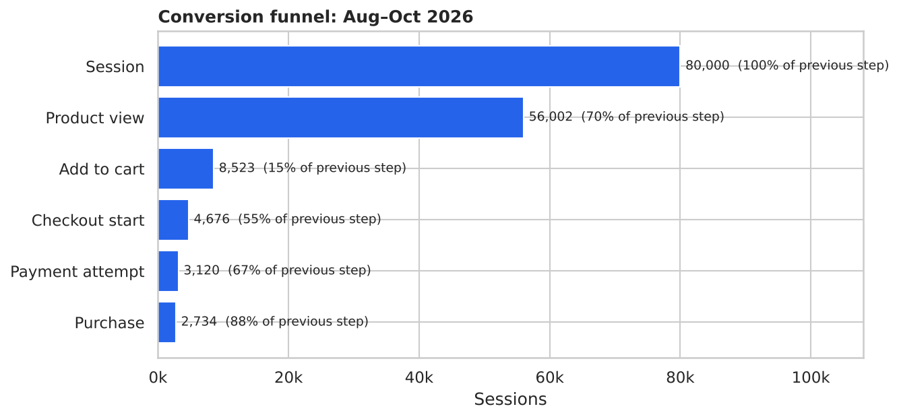
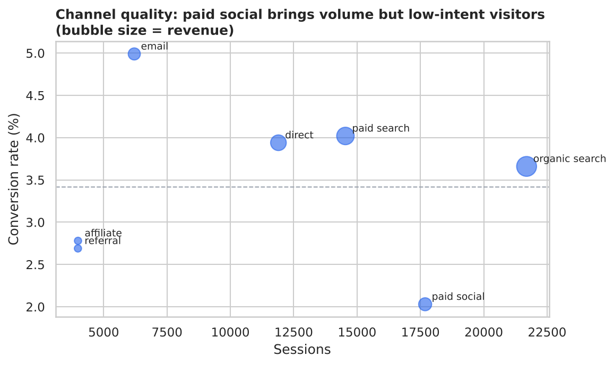
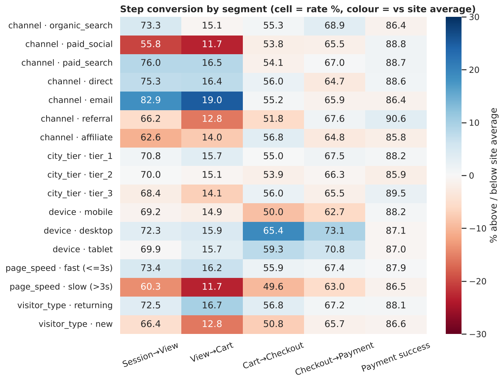
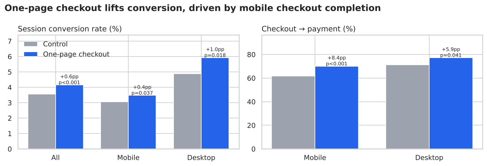
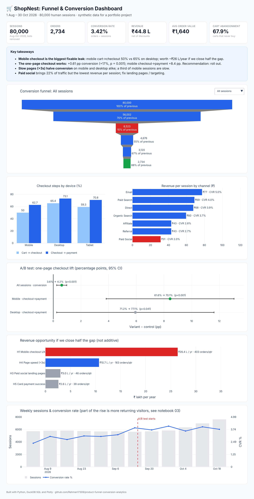

# 🛒 Product Funnel & Conversion Rate Optimization

> **Status:** 🚧 In progress: Day 2 of 3 complete (data quality, EDA, SQL deep-dive, A/B test, dashboard).
> Final recommendations report coming next.

An end-to-end analysis of an e-commerce conversion funnel: from raw, messy clickstream exports to
a clear answer to the question every product and growth team asks:

**"Where are we losing customers, why, and what should we fix first?"**

---

## 📌 Business problem

*ShopNest*, a fictional Indian D2C e-commerce brand, gets ~80,000 sessions a quarter but only **3.4%** of them
turn into orders. Two-thirds of traffic is on mobile, and the product team has just launched a
**one-page checkout** experiment. Leadership wants to know:

1. Which funnel step loses the most customers, and which loss is the most valuable to fix?
2. Which segments (device, channel, city tier, page speed, new vs returning) under-perform?
3. Did the one-page checkout actually work, and should it be rolled out?
4. What is the ₹ impact of each recommendation?

## 🔢 Headline numbers (Aug–Oct 2026, bots excluded)

| Sessions | Orders | Conversion rate | Revenue | AOV | Cart abandonment |
|---|---|---|---|---|---|
| 80,000 | 2,734 | **3.42%** | ₹44.8 lakh | ₹1,640 | **67.9%** |



## 🔍 Findings so far

| # | Finding | Evidence |
|---|---|---|
| 1 | **Mobile converts 41% worse than desktop** (2.84% vs 4.80%) | The gap opens after the cart: cart→checkout 50% vs 65% |
| 2 | **Paid social is the 2nd-largest channel but the weakest** | 2.0% CVR, ₹31 revenue/session vs ₹69 for paid search |
| 3 | **Pages slower than 3s roughly halve conversion** | 1.9% vs ~3.8% below 3s; one-third of mobile sessions are slow |
| 4 | **1 in 5 card payments fails** | Card success 80% vs UPI 90% |
| 5 | **Returning visitors convert 66% better** than new ones | 4.07% vs 2.45% |

<p float="left">
  
  
</p>

## 🧮 SQL deep-dive: what each fix is worth

Seven DuckDB queries in [`/sql`](sql) (CTEs, `UNPIVOT`, window functions, `QUALIFY`, `QUANTILE_CONT`) segment the funnel and
put a ₹ value on each lever, assuming we close **half** the gap to a realistic benchmark:

| Priority | Lever | Est. extra revenue | Why |
|---|---|---|---|
| 1 | **Mobile checkout UX** | **~₹26 L / year** | Mobile cart→payment 31% vs 48% on desktop |
| 2 | Page speed under 3s | ~₹11 L / year | CVR roughly halves above 3s on mobile *and* desktop |
| 3 | Paid social landing pages | ~₹3 L / year | Weak only at the top of the funnel |
| 4 | Card payment success | ~₹2.6 L / year | 80% card vs 90% UPI success |



> ⚠️ **A trap avoided:** conversion rose from ~2.4% to ~4.0% over the quarter, but the share of returning visitors rose from
> 23% to 79% at the same time. A before/after comparison would wrongly credit the new checkout, so we used the A/B test instead.

## 🧪 A/B test: one-page checkout

| Check | Result |
|---|---|
| Sample ratio (50/50) | ✅ 50.2% variant, p = 0.43 |
| Groups balanced (returning, device, channel, speed) | ✅ all p > 0.05 |
| **Primary: session conversion** | **3.55% → 4.16% (+0.61 pp, +17%), 95% CI +0.25 to +0.98 pp, p ≈ 0.001** |
| Mechanism: mobile checkout → payment | 61.6% → 70.1% (+8.4 pp), p < 0.001 |
| Steps *before* checkout (built-in A/A check) | No significant change ✅ |
| Guardrails: AOV, payment success | No significant change ✅ |
| Regression-adjusted (device, visitor type, channel, speed) | Odds ratio 1.19 (1.08–1.32), p < 0.001 |
| Power | Minimum detectable effect +0.52 pp; observed +0.61 pp |

**Decision:** roll out to mobile now; roll out to desktop with a small holdout (desktop lift positive but not significant
after a Bonferroni correction). Expected value at today's traffic: **~₹32 L / year** (range ₹13–51 L).



## 📊 Interactive dashboard

[`dashboard/index.html`](dashboard/index.html) is a single file: download it and open it in any browser. It has KPI cards, a funnel you can
filter by segment, device/channel comparison, A/B lift with confidence intervals, opportunity sizing and the weekly trend.



## 🧰 Tech stack

**Python** (pandas, NumPy, matplotlib, seaborn, SciPy, statsmodels) · **SQL** (DuckDB) · **Jupyter** · **Plotly** (dashboard)

## 🗂️ Project structure

```
├── data/
│   ├── raw/                  # sessions, events, orders (gzipped CSV, as exported)
│   └── processed/            # cleaned parquet tables (created by src/clean.py, git-ignored)
├── docs/
│   └── data_dictionary.md    # every column, funnel definition, metric formulas
├── notebooks/
│   ├── 01_data_quality_and_cleaning.ipynb
│   ├── 02_exploratory_analysis.ipynb
│   ├── 03_sql_funnel_analysis.ipynb
│   └── 04_ab_test_one_page_checkout.ipynb
├── sql/                      # 00_setup_views + 7 analysis queries (DuckDB)
├── dashboard/
│   └── index.html            # interactive Plotly dashboard
├── src/
│   ├── generate_data.py      # reproducible synthetic data generator
│   ├── clean.py              # cleaning pipeline + validation (auditable log)
│   └── build_dashboard.py    # builds dashboard/index.html
├── reports/
│   └── data_quality_log.csv  # every cleaning rule and rows affected
├── images/                   # charts used in this README
└── LEARNING.md               # day-by-day log of what was done and why
```

## ▶️ How to run

```bash
git clone https://github.com/Rahman17309/Product-Funnel-Conversion-Analytics.git
cd Product-Funnel-Conversion-Analytics
pip install -r requirements.txt

python src/generate_data.py   # optional: regenerate raw data (already included)
python src/clean.py           # builds data/processed/ + reports/data_quality_log.csv
python src/build_dashboard.py # builds dashboard/index.html
jupyter notebook notebooks/   # run 01 → 04

# or run any SQL file directly in the DuckDB CLI:
duckdb -c ".read sql/00_setup_views.sql" -c ".read sql/07_opportunity_sizing.sql"
```

## 🧹 Data quality: what was fixed

Real exports are messy, so the raw data deliberately contains the problems analysts meet every day.
Every fix is logged in [`reports/data_quality_log.csv`](reports/data_quality_log.csv).

| Issue | Rows affected | Fix |
|---|---|---|
| Bot / crawler sessions (≥15 product views in ≤60s, or 0 ms load time) | 2,000 sessions | Excluded |
| Duplicate events (double-fired tracking pixel) | 2,386 events | Dropped |
| Mixed timestamp formats (ISO + DD/MM/YYYY) | 11,288 events | Parsed both explicitly |
| Inconsistent channel labels (14 labels for 7 channels) | 4,959 sessions | Standardised |
| Missing device | 945 sessions | Set to `unknown`, kept |
| QA test orders (₹1) and duplicated order rows | 55 orders | Dropped |

Validation checks (all passing): no session skips a funnel stage; every purchase event has exactly one order.

## 🗓️ Roadmap

- [x] **Day 1:** project setup, data dictionary, data-quality pipeline, EDA
- [x] **Day 2:** SQL funnel deep-dive (DuckDB), segment analysis, A/B test with significance, interactive dashboard
- [ ] **Day 3:** ₹-impact sizing, recommendations report, final README

---

*Data is synthetic and generated for this portfolio project; it is calibrated to public e-commerce benchmarks
and contains no real customer information.*
